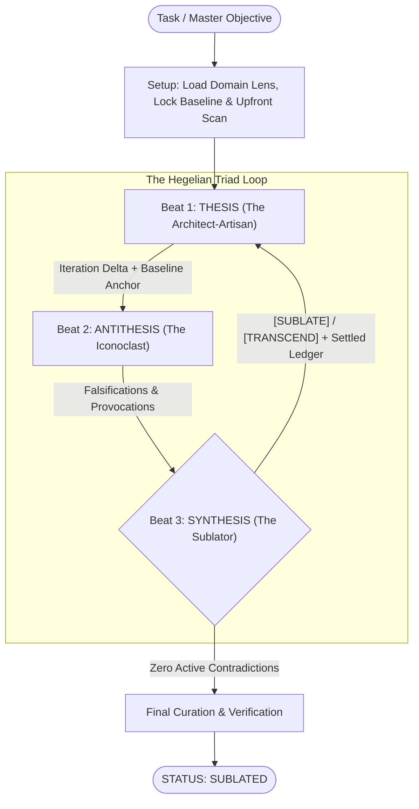

# sublate
Autonomous Hegelian dialectic workflow for AI agents: *Thesis → Antithesis → Synthesis*.

## Why
Most multi-agent coding loops fall into one of two traps: either a single agent grades its own homework, or a "worker and reviewer" read from the exact same checklist—creating a bureaucratic monoculture where iterations slowly sandpaper off all elegance into a bloated committee compromise.

`sublate` (from Hegel's *Aufheben*: to simultaneously *cancel* flaws, *preserve* essence, and *elevate* to a higher plane) replaces the checklist monoculture with **three orthogonal forces** designed to collide productively, paired with pluggable domain lenses.

## How
* **Orthogonal Charters**: Each agent optimizes for a distinct structural and aesthetic vector instead of repeating the same rubric.  
* **Persistent Subagents & Delta Auditing**: Thesis and Antithesis persist across iterations and audit the iteration delta against the immutable baseline anchor (`<base_commit>..HEAD`) instead of re-reading the entire codebase from scratch on every pass.  
* **The Settled Ledger**: Negated critiques (`[NEGATE]`) become settled law passed into subsequent beats so Antithesis cannot re-litigate rejected points or cause ping-pong oscillation.  
* **Pluggable Domain Lenses**: Decouples the universal dialectic engine ([`SKILL.md`](./SKILL.md)) from domain rubrics ([`lenses/`](./lenses/)).  



## The Triad

| Force | Persona | Structural Vector | Aesthetic Vector |
| :--- | :--- | :--- | :--- |
| **1. THESIS** | **The Architect-Artisan** *(Assertion)* | Single Source of Truth, Symmetry & Terseness, Fail-Loud Clarity, Upfront Consolidation | **Inevitability & Negative Space** — Sculpting by subtraction; work that feels *discovered* rather than bolted together with glue. |
| **2. ANTITHESIS** | **The Iconoclast** *(Negation)* | Falsification with Root-Cause Proof, Boundary Stress-Testing, Contract Auditing | **Challenging Mediocrity** — Calling out clunky "Rube Goldberg" compliance and offering *Structural Provocations* to collapse complexity. |
| **3. SYNTHESIS** | **The Sublator** *(Elevation)* | Real-World Blast Radius, Root-Cause over Band-Aid, Upstream Hygiene, Settled Ledger | **Anti-Committee Stewardship** — Forbidding defensive patchwork that scars the design; demanding fixes that deepen elegance. |

### Verdicts (Beat 3)
* **`[SUBLATE]`**: Valid flaw or contract drift; fix the root producer cleanly without consumer band-aids.  
* **`[TRANSCEND]`**: Valid structural provocation; collapse complexity by rethinking the model.  
* **`[NEGATE]`**: 0%-probability fantasy or unproved producer path; recorded into the **Settled Ledger** as settled law.  
* **`[EXTERNALIZE]`**: Issue belongs in an upstream library or external boundary.  

> [!IMPORTANT]
> **The Terminal Invariant**: Synthesis is **always** the terminal actor. A `sublate` run can **never** terminate directly after a Thesis turn. The loop concludes only when an audit cycle produces zero active `[SUBLATE]` or `[TRANSCEND]` directives.

## Lenses & Models

```text
sublate/
├── SKILL.md                      # Universal Hegelian Triad Engine, Role Charters & Model Matrix
└── lenses/
    └── software-engineering.md   # The 7 Core Engineering Principles + Git Baseline Protocol
```

* **[`lenses/software-engineering.md`](./lenses/software-engineering.md)** *(default for code repos)*: Enforces the 7 Core Engineering Principles (*Producer Check, Fail-Loud, Single-Source-of-Truth, Real-World Blast Radius, Upstream Origin, Symmetry & Terseness, Pragmatic DRY*) and the Git Baseline & History Curation protocol.  
* **Custom Lenses**: Add markdown rubrics to `lenses/`, drop a `.sublate.md` in a project root, or pass `--lens <name>` at invocation.  
* **Model Matrix**: Subagents default to `inherit`, or can be routed per role on demand (e.g. a fast craft model for Thesis, a deep-reasoning model for Antithesis, and your lead model for Synthesis).  

## Install

Follows the open [Agent Skills](https://agentskills.io) format ([`SKILL.md`](./SKILL.md)).

### Antigravity / Gemini CLI (`agy`)
```sh
$ git clone https://github.com/jessetane/sublate.git ~/.gemini/config/skills/sublate
```

### Claude Code
```sh
$ git clone https://github.com/jessetane/sublate.git ~/.claude/skills/sublate
```

## Usage
```text
/sublate <feature, refactor, or architectural goal>
```

## License
MIT
