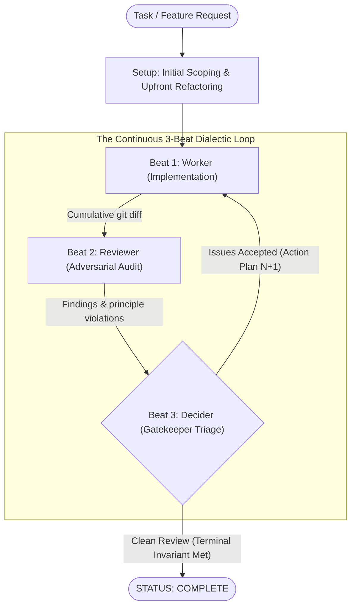

# Crucible

An autonomous, dialectic multi-agent development workflow for AI coding assistants.

Crucible replaces linear AI execution with a rigorous, adversarial feedback loop governed by a senior technical lead persona. Instead of letting a single agent write code and self-certify its own work, Crucible orchestrates a dialectic between implementation, adversarial audit, and architectural triage.



---

## How It Works

Crucible organizes development into a continuous **3-Beat State Machine**:

1. **Beat 1: Implementation (Worker)**  
   A focused subagent executes concrete code changes against the active plan, validates edits locally, and creates logical, focused git commits.
2. **Beat 2: Adversarial Audit (Reviewer)**  
   An isolated subagent audits the cumulative git diff (`git diff <base_commit>..HEAD`) against the task specification and architectural rubric. It hunts for logic bugs, broken symmetry, edge cases, and code duplication, citing exact files and line numbers.
3. **Beat 3: Gatekeeper Triage & Decision (Decider)**  
   The primary agent acts as technical lead and gatekeeper. It triages reviewer findings, discards defensive bloat or 0%-probability theoretical edge cases, accepts root-cause fixes, and formulates the next action plan.

> [!IMPORTANT]
> **The Terminal Invariant**: The Decider is **always** the terminal actor. A Crucible run can **never** terminate directly after a Worker turn. Every code modification must undergo an adversarial audit and decider review before completion. The loop terminates only when a review cycle completes with zero accepted blocking issues.

---

## Shared Engineering Principles

Rather than relying on vague prompts like "write clean code," all three roles in Crucible are aligned around a **shared architectural rubric** defined in [SKILL.md](./SKILL.md):

* **Root Cause over Band-Aids**: Consumer defenses (`?.`, empty fallbacks) that mask bugs are rejected; fixes must be applied to the producer.
* **Fail Loud**: Silent fallbacks that swallow exceptions or broken invariants are forbidden.
* **Single Source of Truth**: Duplicate execution paths and backwards-compatibility shims are eliminated in favor of one canonical implementation.
* **Pragmatic DRY as a Guiding Light**: Repetition and competing patterns signal an opportunity to abstract, prioritized upfront before layering on new features.
* **API Symmetry & Terseness**: Enforces paired lifecycle verbs, concise naming without redundant prefixes, and cross-layer noun consistency.

Because the Worker, Reviewer, and Decider all reference the same rubric, audit findings cite specific principles by name, eliminating ambiguous review feedback.

For the full text and definitions of all 7 principles, see [SKILL.md](./SKILL.md).

---

## Installation

Crucible follows the open **[Agent Skills](https://agentskills.io)** format (`SKILL.md`), making it natively portable across AI coding platforms.

### Antigravity / Gemini CLI (`agy`)
Symlink this repository into your global Antigravity skills directory:

```bash
mkdir -p ~/.gemini/config/skills
ln -s "$(pwd)" ~/.gemini/config/skills/crucible
```

Trigger it in any conversation:
```text
Run crucible on this task: <your feature or refactoring description>
```

### Claude Code
Symlink this repository into your global Claude Code skills directory:

```bash
mkdir -p ~/.claude/skills
ln -s "$(pwd)" ~/.claude/skills/crucible
```

Trigger it via slash command:
```text
/crucible <your task>
```

### Standalone / Any Agent
Point any AI agent directly to [SKILL.md](./SKILL.md):
```text
Read SKILL.md and execute the 3-beat dialectic loop for this task.
```
