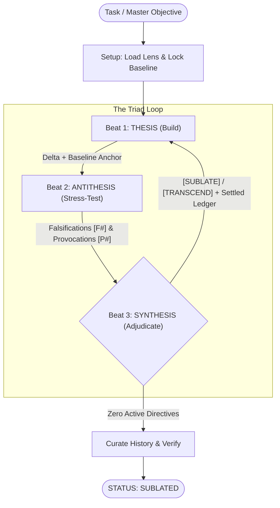

# sublate
Hegelian dialectic workflow for AI agents: *Thesis → Antithesis → Synthesis*.

## Why
When I use agents to build or refactor something non-trivial, I end up doing the same manual loop: have an agent build the thing, get another pass to poke holes in it, and then step in myself to throw out the pedantic nitpicks so the "fixes" don't litter the codebase with defensive band-aids (`?.`, fallback soup, extra flags).

`sublate` (from Hegel's *Aufheben*: to simultaneously *cancel*, *preserve*, and *elevate*) automates that loop with three distinct agent roles and pluggable domain lenses.

## How
* **Thesis (Builder)**: Writes the cleanest, most direct implementation (`self`).  
* **Antithesis (Red-Team)**: Runs `git diff`, tests, and reproducers to break assumptions (`self`, read/exec only), and must trace the exact producer path (`file:line`) before claiming any state bug.  
* **Synthesis (Arbiter)**: Filters Antithesis findings by real-world blast radius, rejects consumer band-aids, records rejected nitpicks into a **Settled Ledger** so they aren't re-litigated, and decides whether the next pass should reuse the warm subagent (`send_message`) or spawn a fresh one (`invoke_subagent`).  
* **Domain Lenses**: Role-specific rubrics (`THESIS_LENS`, `ANTITHESIS_LENS`, `SYNTHESIS_LENS`) in [`lenses/`](./lenses/) that plug into [`SKILL.md`](./SKILL.md).  



### Verdicts (Beat 3)
* **`[SUBLATE]`**: Valid flaw or contract drift; fix the upstream root cause cleanly without consumer band-aids.  
* **`[TRANSCEND]`**: Valid structural provocation; collapse complexity by rethinking the model.  
* **`[NEGATE]`**: 0%-probability edge case or unproved causal path; recorded into the **Settled Ledger** as settled law.  
* **`[EXTERNALIZE]`**: Issue belongs in an upstream library or external boundary.  

> [!IMPORTANT]
> Synthesis is always the terminal actor. A run never ends directly after a Thesis pass; it finishes only when an Antithesis + Synthesis audit cycle produces zero active `[SUBLATE]` or `[TRANSCEND]` directives.

## Lenses & Models

```text
sublate/
├── SKILL.md                      # Dialectic engine, role charters & prompt blueprints
└── lenses/
    ├── software-engineering.md   # 7 core engineering principles + git baseline protocol
    └── design-rfc.md             # Architectural RFCs, specs & strategy rubric
```

* **[`lenses/software-engineering.md`](./lenses/software-engineering.md)** *(default for code)*: Minimal Mechanism, Single Source of Truth, Upfront DRY, Fix the Producer (Not the Consumer), Fail Loud, Symmetry & Terseness, Native Platform & Dense Style, and Git history curation.  
* **[`lenses/design-rfc.md`](./lenses/design-rfc.md)** *(default for specs/RFCs)*: Falsifiable claims, explicit trade-offs, single canonical model, boundary invariants, and signal-to-noise.  
* **Swapping & Customizing Lenses**:
  1. Pass `--lens <name|path>` in the prompt (e.g. `--lens design-rfc` or `--lens ./my-lens.md`), or let Synthesis auto-detect from the task.  
  2. Drop a `.sublate.md` in a repo root to append project-specific rules onto the base lens (or include `THESIS_LENS` / `ANTITHESIS_LENS` / `SYNTHESIS_LENS` blocks to replace the base lens entirely).  
  3. Add `<name>.md` files to `lenses/` to make `--lens <name>` available globally.  
* **Models**: Subagents default to `inherit`, or can be overridden per role in the prompt.  

## Install

Follows the [Agent Skills](https://agentskills.io) format ([`SKILL.md`](./SKILL.md)).

### Antigravity / Gemini CLI (`agy`)
```sh
$ git clone https://github.com/jessetane/sublate.git ~/.gemini/config/skills/sublate
```

### Claude Code
```sh
$ git clone https://github.com/jessetane/sublate.git ~/.claude/skills/sublate
```

## Usage
```text
# Default (auto-detects lens from task)
/sublate unify watcher lifecycle and remove duplicate event emitters

# Swap to a specific built-in or custom lens
/sublate --lens design-rfc draft the multi-region replication spec
/sublate --lens ./docs/security-lens.md harden the token verification boundary

# Override models per role
/sublate with flash for thesis and pro for antithesis: refactor the query planner
```

## License
MIT
