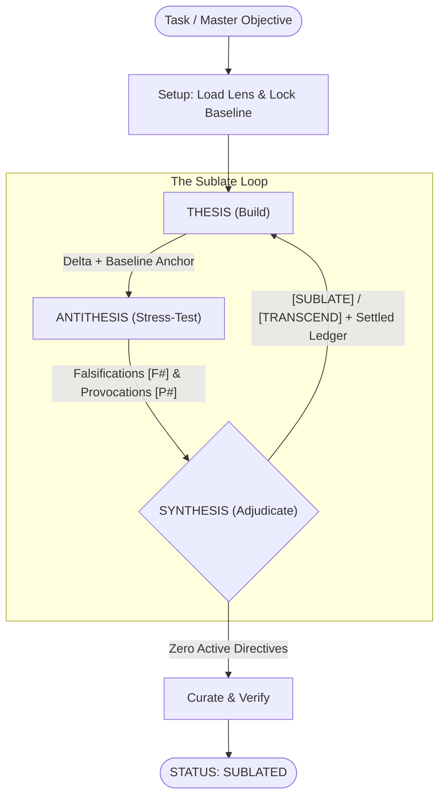

# sublate
Hegelian dialectic workflow for agents: *Thesis → Antithesis → Synthesis*.

## Why
Solitary perspectives suffer from structural blind spots. Asking a single agent to simultaneously build, audit and curate its own work inevitably leads to defensive hedging, confirmation bias and clunky compromise. Durable and elegant engineering and design are forged through tension: an artisan to build, an iconoclast to challenge and an arbiter to elevate.

After defining an objective, I frequently find myself traversing this loop by hand (often 3-5 iterations): spawn an agent to build, spawn another to tear it apart, triage the findings and repeat until convergence.

`sublate` (from Hegel's *Aufheben*: to simultaneously *cancel*, *preserve* and *elevate*) operationalizes this loop into an autonomous triad with pluggable domain lenses.

## How
* **Thesis (Builder)**: Creates or refactors the deliverable in its cleanest, most direct form (`self`).  
* **Antithesis (Red-Team)**: Stress-tests the work via read-only inspection and empirical checks (`self`, read/exec only) across two channels:
  * **Falsifications (`[F#]`)**: Concrete defects, broken invariants or physical clashes. Must trace the **upstream source/producer** (e.g. the originating code path or base CAD sketch/placement) rather than demanding downstream band-aids.  
  * **Structural Provocations (`[P#]`)**: Holistic architectural and design critiques that challenge clunky "Rube Goldberg" compliance and propose simpler models.  
* **Synthesis (Arbiter)**: Adjudicates each finding by real-world blast radius, rejects downstream band-aids in favor of upstream root-cause fixes, records rejected nitpicks into a **Settled Ledger** so they aren't re-litigated and decides whether the next pass should reuse the warm subagent (`send_message`) or spawn a fresh one (`invoke_subagent`).  
* **Domain Lenses**: Pluggable role-specific rubrics (`THESIS_LENS`, `ANTITHESIS_LENS`, `SYNTHESIS_LENS`) in [`lenses/`](./lenses/) that adapt [`SKILL.md`](./SKILL.md) to the target domain (e.g. git diffs, unit tests and `file:line` traces for software vs. B-Rep solid validation, clash volumes and sketch/datum traces for CAD/BIM).  



### Synthesis Verdicts
* **`[SUBLATE]`**: Valid flaw or contract drift (`[F#]`); fix the upstream root cause cleanly without downstream band-aids.  
* **`[TRANSCEND]`**: Valid structural provocation (`[P#]`); collapse complexity by rethinking the model or architecture.  
* **`[NEGATE]`**: 0%-probability edge case or unproved causal path; recorded into the **Settled Ledger** as settled law.  
* **`[EXTERNALIZE]`**: Issue belongs in an upstream dependency or external boundary.  

> [!IMPORTANT]
> Synthesis is always the terminal actor. A run never ends directly after a Thesis pass; it finishes only when an Antithesis + Synthesis audit cycle produces zero active `[SUBLATE]` or `[TRANSCEND]` directives.

## Lenses & Models

```text
sublate/
├── SKILL.md                      # Dialectic engine, role charters & prompt blueprints
└── lenses/
    ├── software-engineering.md   # Example lens for code & systems architecture
    └── cad-bim.md                # Example lens for parametric CAD & OpenBIM (FreeCAD)
```

The built-in files in [`lenses/`](./lenses/) are examples distilled from my personal conversation history, you should bring your own:

* **Customize globally**: Edit the examples in [`lenses/`](./lenses/) or add new `<name>.md` files to encode your own taste and stack.  
* **Per-repo `.sublate.md`**: Drop a `.sublate.md` in any repo root to append project-specific rules onto the base lens (or define `THESIS_LENS` / `ANTITHESIS_LENS` / `SYNTHESIS_LENS` blocks to replace it).  
* **Select per run**: Synthesis auto-detects the lens from the task or you can pass `--lens <name|path>` in the prompt.  
* **Per-role models**: Subagents default to `inherit` or can be overridden per role in the prompt.  

## Install

Follows the [Agent Skills](https://agentskills.io) format ([`SKILL.md`](./SKILL.md)).

### Antigravity / Gemini CLI (`agy`)
```sh
$ git clone https://github.com/jessetane/sublate.git ~/.gemini/config/skills/sublate
```

### Claude Code
```sh
$ git clone https://github.com/jessetane/sublate.git ~/.claude/skills/sublate
```

### Cursor / Windsurf / Codex / Other Platforms
Sublate adheres to the open [Agent Skills](https://agentskills.io) specification. For platforms without automatic skill discovery:
* Place the repo in your workspace or prompt rules directory (e.g. `.cursorrules`, `.windsurfrules` or project instructions).
* Reference [`SKILL.md`](./SKILL.md) in your initial prompt to instruct the agent to run as **Synthesis** or use the prompt blueprints in Part III directly across separate chat threads/tabs.

## Usage
```text
# Default (auto-detects software-engineering or cad-bim from task)
/sublate unify watcher lifecycle and remove duplicate event emitters

# Parametric CAD / OpenBIM in FreeCAD
/sublate --lens cad-bim frame the south wall and ledger assembly from global-vars

# Custom lens file or per-role model overrides
/sublate --lens ./docs/security-lens.md harden the token verification boundary
/sublate with flash for thesis and pro for antithesis: refactor the query planner
```

## License
MIT
