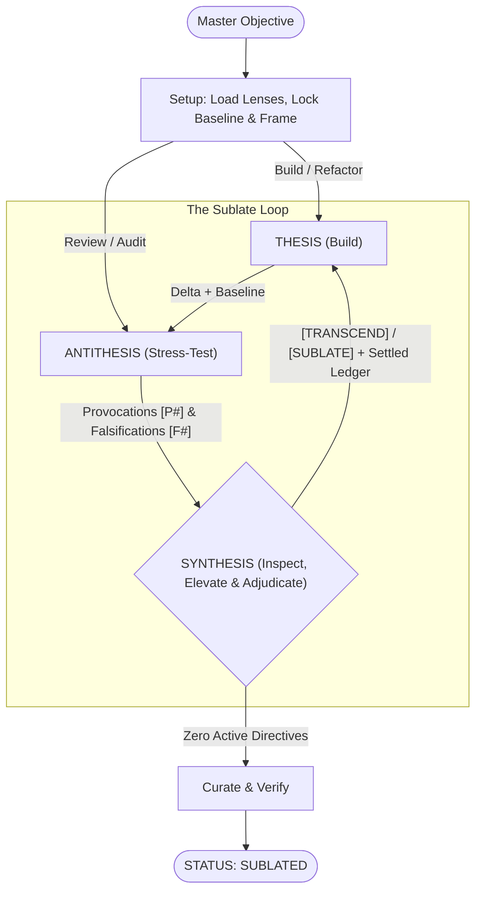

# sublate

Hegelian dialectic workflow for agents: *Thesis → Antithesis → Synthesis*.

## Why

After defining an objective, I frequently find myself running this loop by hand (often 3–5 iterations): spawn an agent to build, spawn another to tear it apart, triage the findings and repeat until convergence.

`sublate` (from Hegel's *Aufheben*: to simultaneously *cancel*, *preserve* and *elevate*) automates that loop into a domain-agnostic triad with pluggable lenses.

## How

* **Thesis (Build)**: Creates or refactors the deliverable in its cleanest, most direct form.  
* **Antithesis (Stress-Test)**: Challenges the work via read-only inspection and empirical checks, moving from broad architectural strokes to minute detail:  
  * **Structural Provocations (`[P#]`)**: Whole-system design critiques that call out clunky "Rube Goldberg" machinery, split state or leaky boundaries and propose simpler models before nitpicking line-level bugs inside flawed structures.  
  * **Falsifications (`[F#]`)**: Concrete defects, broken invariants or contract drift—each required to trace the **upstream source/producer** rather than demanding downstream band-aids.  
* **Synthesis (Elevate)**: Inspects contested areas directly between beats, collapses related defects into cohesive top-down architectural blueprints (**structural refactors & consolidations first → local bug fixes second**), records rejected nitpicks into a **Settled Ledger** so they are never re-litigated and routes each pass via warm continuity (`send_message`) or fresh renewal (`invoke_subagent`).  
* **Domain Lenses**: Pluggable domain rubrics in [`lenses/`](./lenses/) pairing shared domain principles with role-specific dynamics.  



### Synthesis Verdicts

* **`[TRANSCEND]`**: Valid structural critique (`[P#]`) or defect cluster rooted in a flawed boundary; collapse complexity by rethinking the model.  
* **`[SUBLATE]`**: Valid defect or drift (`[F#]`); fix the upstream root cause cleanly without downstream band-aids.  
* **`[NEGATE]`**: 0%-probability edge case or unproved causal path; recorded into the **Settled Ledger** as settled law.  
* **`[EXTERNALIZE]`**: Issue belongs in an external dependency or upstream boundary outside scope.  

> [!IMPORTANT]
> Synthesis is always the terminal actor. A run never ends directly after a Thesis pass; it finishes only when an Antithesis + Synthesis audit cycle produces zero active `[SUBLATE]` or `[TRANSCEND]` directives.

## Lenses & Models

```text
sublate/
├── SKILL.md                 # Universal dialectic engine & role mandates
└── lenses/
    ├── software.md          # Code, refactoring & systems architecture
    ├── legal.md             # Commercial contracts & legal agreements
    └── bim-freecad.md       # Parametric CAD & OpenBIM in FreeCAD
```

The built-in files in [`lenses/`](./lenses/) are examples—bring or customize your own:

* **Customize globally**: Edit [`lenses/`](./lenses/) or add new `<name>.md` files to encode your own domain standards.  
* **Per-workspace `.sublate.md`**: Drop a `.sublate.md` in any workspace root to layer project-specific rules onto the active lens (or set `mode: replace` to use it standalone).  
* **Select or compose per run**: Synthesis auto-selects matching lens(es) from [`lenses/`](./lenses/), or you can pass `--lens <name|path>` (comma-separated to combine multiple).  
* **Per-role models**: Subagents default to `inherit` or can be overridden per role in the prompt.  

## Install

Follows the [Agent Skills](https://agentskills.io) format ([`SKILL.md`](./SKILL.md)).

### Antigravity / Gemini CLI (`agy`)
```sh
$ git clone https://github.com/jessetane/sublate.git ~/.gemini/config/skills/sublate
```

### Claude Code
```sh
$ git clone https://github.com/jessetane/sublate.git ~/.claude/skills/sublate
```

### Cursor / Windsurf / Codex / Other Platforms
Place the repo in your workspace or rules directory and reference [`SKILL.md`](./SKILL.md) to run the triad.

## Usage
```text
# Auto-detects matching lens from task
/sublate unify watcher lifecycle and remove duplicate event emitters

# Legal contract drafting / review
/sublate --lens legal tighten the indemnity and limitation of liability clauses in msa.md

# Parametric CAD / OpenBIM in FreeCAD
/sublate --lens bim-freecad frame the south wall and ledger assembly from global-vars

# Custom lens or per-role model overrides
/sublate --lens ./docs/security-lens.md harden the token verification boundary
/sublate with flash for thesis and pro for antithesis: refactor the query planner
```

## License
MIT
